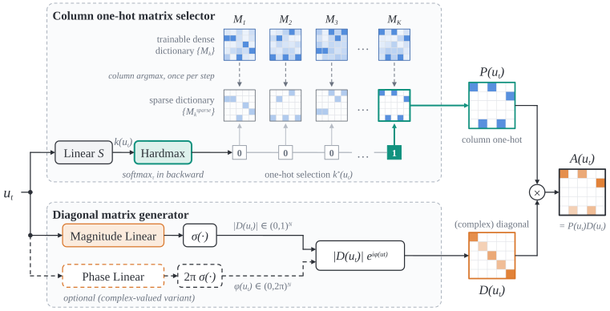

# Flash PD-SSM

PyTorch layer and CUDA kernel for **Flash PD-SSM** ([Terzić et al., 2026](https://arxiv.org/abs/2605.19150)). Flash PD-SSM maintains a trainable set of structured sparse matrices, a single one of which is discretely selected at each time-step, enabling FSA expressiveness at the level of unstructured matrices.

<p align="center"></p>

## Model

The transition matrix is $`A(u_t) = P(u_t)\,D(u_t)`$. The sparse matrices are generated from a dictionary of $`K`$ dense matrices $`M_k`$ by selecting the largest element in each column, and a single one of them is selected at each time-step:

```math
M_k^{\text{sparse}}[j] = \arg\max_i M_k[i,j], \qquad
k(u_t) = S u_t, \qquad
k^*(u_t) = \arg\max_k\, k(u_t)_k, \qquad
P(u_t) = M^{\text{sparse}}_{k^*(u_t)}, \qquad
D(u_t) = \sigma(W_D u_t).
```

**Forward pass.** With $`P_t := P(u_t)`$ and $`D_t := D(u_t)`$,

```math
x_t = P_t D_t\, x_{t-1} + b_t,
```

computed by a three-phase chunkwise parallel scan (local aggregation, global carry, carry correction) in $`O(LN)`$ time and memory.

**Backward pass.** A reverse scan yields $`\lambda_t = \partial \ell / \partial x_t`$, from which $`\partial \ell / \partial b_t = \lambda_t`$ and $`\partial \ell / \partial D_t = (P_t^\top \lambda_t) \odot x_{t-1}`$. Both argmaxes are approximated by straight-through estimation, reusing the discretely selected $`P_t`$:

```math
\frac{\partial \ell}{\partial M_k} \approx \sum_{t:\, k^*(u_t)=k} \lambda_t (D_t x_{t-1})^\top \, \frac{\partial\, \mathrm{softmax}(M_k)}{\partial M_k},
\qquad
\frac{\partial \ell}{\partial k(u_t)} \approx \big[\lambda_t^\top P_k D_t x_{t-1}\big]_{k=1}^{K} \, \frac{\partial\, \mathrm{softmax}(k(u_t))}{\partial k(u_t)},
```

with the softmax taken over the rows of $`M_k`$ and over $`k`$, respectively.

## Install

Needs PyTorch and a CUDA toolkit (`nvcc`) of the same major version as PyTorch's CUDA. Build on a GPU node.

```bash
git clone <this repo> pdssm && cd pdssm
pip install --no-build-isolation -e .
python tests/test_pdssm.py
```

- Set `TORCH_CUDA_ARCH_LIST` to your GPU (e.g. `9.0` for H100/H200) if the build picks the wrong architecture.
- CUDA 12.x needs `gcc` ≤ 13.
- Without a GPU: `PDSSM_SKIP_CUDA_BUILD=1 pip install --no-build-isolation -e .` (slow PyTorch scan).

## Use

```python
from pdssm import FlashPDSSM

layer = FlashPDSSM(embed_size=256, state_size=16, num_heads=4, dict_size=6).cuda()
y = layer(x)  # x: (batch, length, 256)
```
## Citation

If you use this code, please cite our NeurIPS 2026 paper (\* equal contribution):

```bibtex
@inproceedings{terzic2026flashpdssm,
  title     = {Flash PD-SSM: Memory-Optimized Structured Sparse State-Space Models},
  author    = {Terzi{\'c}, Aleksandar and Carzaniga, Francesco and Menet, Nicolas and Biehl, Yannick and Hersche, Michael and Hofmann, Thomas and Rahimi, Abbas},
  booktitle = {Advances in Neural Information Processing Systems},
  volume    = {39},
  year      = {2026},
  note      = {Aleksandar Terzi{\'c} and Francesco Carzaniga contributed equally}
}
```
